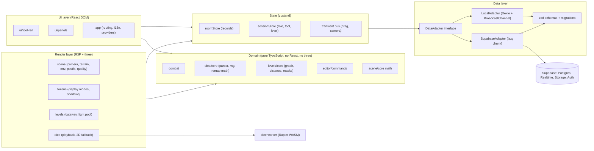
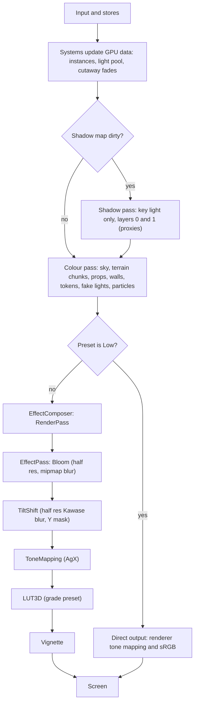
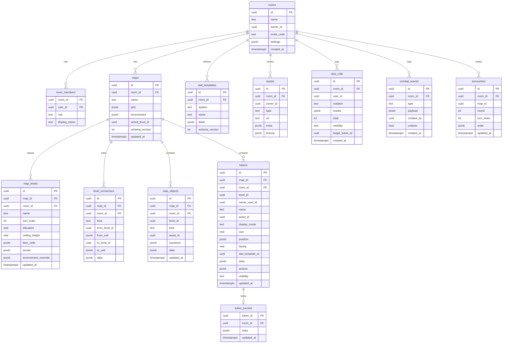
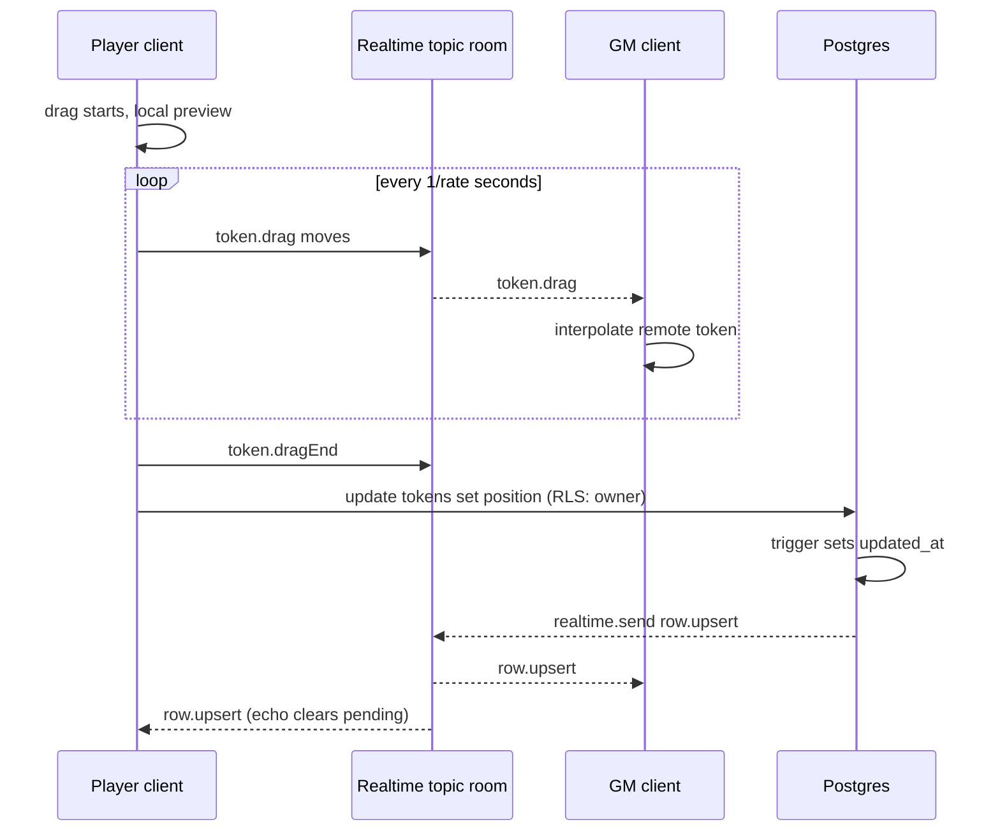
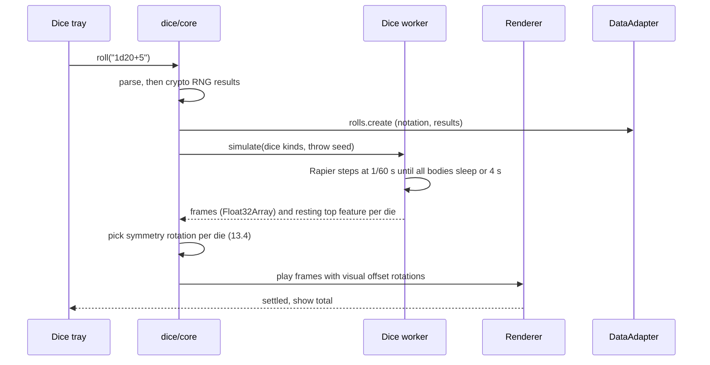
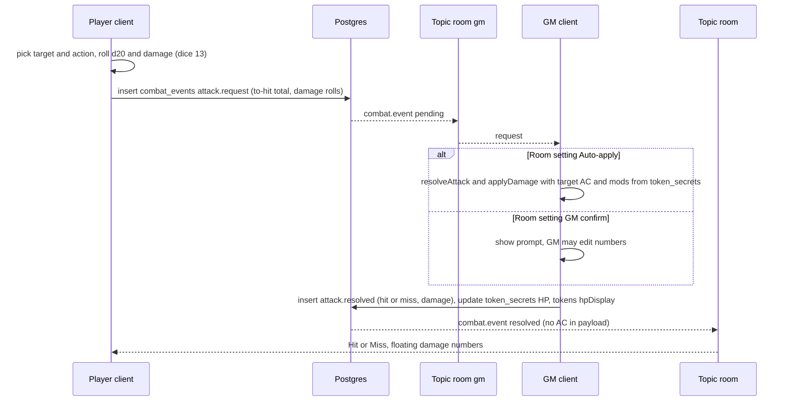

# Engineering.md: DioramaTable

> **Status:** Draft for review (Phase 0). No application code exists yet.
> **Date:** 2026-10-17
> **Companion documents:** `Prompt.md` (the brief), `Visual.md` (art and UX), `List_skill.md` (agent skills).
> Section references like "Prompt §8" point to `Prompt.md`.

This document turns the brief into an engineering design. It records every decision that
affects architecture. Where this design changes something in the brief, the change is marked
**[Δ Prompt]** and explained. Version numbers were checked against the npm registry on the date above.

---

## Contents

1. [Decision summary](#1-decision-summary)
2. [Standards and sources](#2-standards-and-sources)
3. [Technology baseline](#3-technology-baseline)
4. [System architecture](#4-system-architecture)
5. [Runtime model](#5-runtime-model)
6. [World model](#6-world-model)
7. [Rendering pipeline](#7-rendering-pipeline)
8. [Camera and input](#8-camera-and-input)
9. [Multi-level scenes](#9-multi-level-scenes)
10. [Map builder](#10-map-builder)
11. [Data layer](#11-data-layer)
12. [Realtime sync protocol](#12-realtime-sync-protocol)
13. [Dice](#13-dice)
14. [Stats and combat](#14-stats-and-combat)
15. [UI architecture](#15-ui-architecture)
16. [Assets pipeline](#16-assets-pipeline)
17. [Performance budget](#17-performance-budget)
18. [Test plan](#18-test-plan)
19. [Security and privacy](#19-security-and-privacy)
20. [Build, CI and deploy](#20-build-ci-and-deploy)
21. [Risks and mitigations](#21-risks-and-mitigations)
22. [Open questions](#22-open-questions)
23. [Appendix: how the installed skills were used](#23-appendix-how-the-installed-skills-were-used)

---

## 1. Decision summary

| # | Decision | Why | Changes the brief? |
|---|---|---|---|
| D1 | WebGL2 renderer (three.js `WebGLRenderer`), not WebGPU | `postprocessing` and `@react-three/postprocessing` are WebGL-only; WebGL2 is the widest mobile target | No |
| D2 | TypeScript **6.0.x**, not 7.0 | `typescript-eslint` currently supports TypeScript `>=4.8.4 <6.1.0` | No |
| D3 | Non-key point lights use a **custom light pool** in the shader, not three.js `PointLight` | three.js filters lights by *camera* layers only, so it cannot mask lights per level (checked in `WebGLRenderer.js`). Changing the light count also recompiles every lit shader | No (implements Prompt §5.10) |
| D4 | Token shadow proxies live on **layer 1**, rendered only by shadow cameras | `WebGLShadowMap` uses `shadow.camera.layers` when set (checked in source), so proxies never draw in the colour pass | No |
| D5 | Dice "face remap" is done by a **symmetry rotation** of the visual mesh | Shows the right face for any landing, keeps standard numbering (opposite faces sum correctly), needs no texture rebuild | Implements Prompt §9 differently, same outcome **[Δ Prompt]** |
| D6 | Secret stats (AC, damage modifiers, GM-only fields) move to a **`token_secrets`** table | Row-level security works per row, not per JSON key; players must never receive AC (Prompt §11.3) | Adds a table **[Δ Prompt]** |
| D7 | **The GM's client** resolves attacks in v1 (open question Q1) | Players cannot write enemy HP under RLS, and only the GM may read AC. Needs no server code | Clarifies Prompt §11 |
| D8 | Realtime uses **Broadcast only** (client broadcast + database-trigger broadcast), on private channels, no Postgres Changes | Postgres Changes does not apply RLS to deletes and checks every event per subscriber; Broadcast lets hidden data go to a GM-only topic | Clarifies Prompt §10.3 |
| D9 | Token drag broadcast rate is **adaptive** (max 15 Hz) | Supabase Free allows 100 Realtime messages/s per project, counting sent *and* delivered. 15 Hz with 7 clients is 105/s | **[Δ Prompt]** |
| D10 | Env var `VITE_SUPABASE_PUBLISHABLE_KEY` (still accepts `VITE_SUPABASE_ANON_KEY`) | Supabase is deprecating `anon` keys by the end of 2026 | **[Δ Prompt]** |
| D11 | `room_id` is copied onto every room-scoped table | RLS policies stay join-free and indexable (Supabase RLS performance guidance) | Adds columns **[Δ Prompt]** |
| D12 | Combat rules are pluggable **rules profiles** (`dnd5e`, `pf2e`, `generic`) | PF2e resistance is a flat reduction, not halving; one hard-coded rule would be wrong for a shipped template | Clarifies Prompt §11 |
| D13 | Props render through `BatchedMesh` per level when `WEBGL_multi_draw` exists, else `InstancedMesh` per asset | Keeps 200 props across 3 levels inside 150 draw calls | No |
| D14 | Token art, labels and terrain tiles use **texture arrays** (`DataArrayTexture`) | One draw call per token mode, no atlas bleeding, per-layer updates (`addLayerUpdate`) | No |
| D15 | Client-generated **UUIDv7** primary keys (RFC 9562) | Offline-first local mode, optimistic UI, time-ordered index inserts | No |
| D16 | Added tables: `encounters` (initiative) | Initiative state has no home in the brief's schema | **[Δ Prompt]** |

---

## 2. Standards and sources

Decisions cite these. Where two sources disagreed, the primary source (specification or library source code) won.

| Area | Standard / source |
|---|---|
| Rendering | three.js r186 source and manual; pmndrs `postprocessing` 6.39 type definitions; React Three Fiber 9 docs |
| Database & realtime | Supabase docs (Realtime Authorization, Broadcast, Postgres Changes, Limits, API keys, Anonymous sign-ins), read 2026-10-17; Supabase changelog breaking changes Oct 2025 to Oct 2026; PostgreSQL 17 docs |
| Identifiers | RFC 9562 (UUIDv7) |
| Accessibility | WCAG 2.2 AA (target AAA where cheap: 2.5.5 target size, 2.3.3 animation from interactions) |
| Web performance | Core Web Vitals thresholds (LCP ≤ 2.5 s, INP ≤ 200 ms, CLS ≤ 0.1) |
| Game rules | D&D System Reference Document 5.2 (CC BY 4.0); Pathfinder 2e Remaster rules (ORC License) |
| Hex grids | Red Blob Games, "Hexagonal Grids" (axial coordinates) |
| Colour | Okabe & Ito colour-blind-safe palette (in `Visual.md`) |

**Conflict resolved.** The `threejs-lighting` skill suggests `light.layers` can limit which meshes a light affects. The `r3f-lighting` skill says it cannot. three.js r186 `WebGLRenderer.js` pushes a light when `object.layers.test(camera.layers)` is true, then applies it to every lit material. `r3f-lighting` is right, which leads to decision D3.

---

## 3. Technology baseline

Pinned majors (latest versions on 2026-10-17). Phase 1 pins exact versions in `package.json` and commits the lockfile.

| Package | Version | Note |
|---|---|---|
| Node.js | 22 LTS or newer | supabase-js dropped Node 20 on 2026-06-30 |
| `vite` | 8.x | |
| `react`, `react-dom` | 19.3.x | R3F 9 peer range is `>=19 <19.4` |
| `typescript` | 6.0.x | See D2 |
| `three` | 0.186.x | `shadows="percentage"` for PCF on r182+ |
| `@react-three/fiber` | 9.8.x | |
| `@react-three/drei` | 10.7.x | `CameraControls` (camera-controls 3.1) |
| `postprocessing` / `@react-three/postprocessing` | 6.39.x / 3.2.x | `TiltShiftEffect`, `LUT3DEffect`, `ToneMappingEffect` (AgX) |
| `camera-controls` | 3.1.x | Via drei `CameraControls` |
| `three-mesh-bvh` | 0.9.x | Editor picking on props only (lazy) |
| `zustand` | 5.x | |
| `dexie` | 4.4.x | |
| `zod` | 4.x | |
| `@supabase/supabase-js` | 2.118.x | Lazy-loaded |
| `@dimforge/rapier3d-compat` | 0.21.x | Worker only, lazy-loaded |
| `tailwindcss` | 4.3.x | |
| `i18next` / `react-i18next` | 26.x / 17.x | Thai + English |
| `vitest` / `@playwright/test` | 5.x / 1.64.x | |
| `fast-check` | 4.x | Property tests |
| `size-limit` | 14.x | Bundle budget gate in CI |

---

## 4. System architecture

### 4.1 Module diagram



### 4.2 Module boundaries

Enforced with ESLint `no-restricted-imports` (and `import/no-cycle`) from Phase 1.

| Module | May import | Must not import | Owns |
|---|---|---|---|
| `combat`, `dice/core`, `levels/core`, `editor/commands`, `scene/core`, `ui/tool-rail/core` | each other, `data/schemas` (types only) | `react`, `three`, `data/*/adapters`, `ui` | Pure rules and math. 100 % unit-testable |
| `data` | `zod`, `dexie`, `@supabase/supabase-js` (lazy) | `react`, `three`, `ui`, `scene` | Persistence, realtime transport, validation |
| `state` (`src/app/state`) | `data` (interface only), domain | `three` | App state and the transient bus |
| `scene`, `tokens`, `levels`, `dice` (render parts) | `three`, R3F, drei, domain, `state` | `data` adapters, Supabase | Everything drawn in WebGL |
| `ui` | React, `state`, domain | `three` (except via typed hooks from `scene`) | DOM UI, Tool Rail, panels |

**Rule:** UI and game logic reach the backend only through `DataAdapter` (Prompt §10.1). Supabase is imported in exactly one folder: `src/data/supabase/`.

### 4.3 Folder structure

Follows Prompt §17, with these additions: `src/app/state/`, `src/*/core/` for pure logic, `src/dice/worker/`, `src/combat/rules/`, `tests/e2e/`, `tests/db/` (pgTAP).

```
src/
  app/            routing, providers, i18n, state/ (zustand stores)
  scene/          camera, grid/, terrain/ (chunk mesher), environment/, postfx/, quality/, lightpool/
  levels/         core/ (pure), cutaway, slab masks, connectors, view modes
  tokens/         display modes, billboard shader, shadows, import/crop, labels
  editor/         tools, commands/ (pure), history
  dice/           core/ (parser, rng, symmetry), geometry/, worker/, playback, tray UI
  combat/         rules/ (dnd5e, pf2e, generic), resolve, events (pure)
  data/           adapter.ts, schemas/, migrations/, local/, supabase/, policy/
  ui/             tool-rail/, panels/, command-palette/, shortcuts/
  assets/         manifest loader, caches
public/assets/    manifest.json, models, textures, sprites, luts
supabase/         migrations/, seed.sql, tests/ (pgTAP)
tests/            unit helpers, e2e/ (Playwright)
```

---

## 5. Runtime model

### 5.1 State

| Store | Contents | Update path | Who reads it |
|---|---|---|---|
| `roomStore` | Normalised records (maps, levels, connectors, objects, tokens, templates, rolls, events), keyed by id | `DataAdapter` events and optimistic local writes | React (narrow selectors) and render systems (`subscribe`, no re-render) |
| `sessionStore` | user, role, roomId, activeMapId, **activeLevelId**, viewMode, selection, active tool | UI actions | UI and render |
| `settingsStore` | quality preset, rail side, language, reduced motion, ambient motion | UI; persisted to `localStorage` with a `version` field | UI and render |
| transient bus | live drag positions, remote drag buffers, camera state, pointer | Pointer handlers, realtime | Read only inside `useFrame` via `getState()` |

Rules (from `vercel-react-best-practices` and the R3F skills):

- Never call `setState` per frame. Per-frame values live in refs or the transient bus.
- Render systems (tokens, lights, labels) subscribe with `store.subscribe(selector, cb)` and write GPU attributes directly. React only mounts and unmounts systems.
- Derived data is computed in selectors, not stored.
- `localStorage` data is versioned and minimal.

### 5.2 Render loop: demand rendering

`<Canvas frameloop="demand">`. A frame is drawn only when one of these calls `invalidate()`:

1. Camera controls (drei `CameraControls` invalidates on change and while damping).
2. Store changes that affect the scene (render systems call `invalidate()` after writing attributes).
3. **Animation leases.** `useAnimationLease(id)` holds the loop open until released: token movement, dice playback, damage numbers, cutaway fades, light-pool fades.
4. **Ambient ticker.** Runs only when ambient effects are on (clouds, wind, water, particles, flicker, video maps). It invalidates at 30 Hz on Medium and High and 20 Hz on Low, and stops when "Ambient motion" is off or Reduced Motion is on.

When `document.visibilityState === 'hidden'`: stop the ticker, pause video textures, release Realtime drag interpolation, and set `frameloop` to `"never"`. Restore on `visible`.

### 5.3 Threads

| Thread | Work |
|---|---|
| Main | React, R3F, input, realtime, terrain chunk meshing (budget ≤ 4 ms per chunk; moved to a worker only if measurements fail) |
| Dice worker | Rapier world, dice simulation, returns recorded frames (transferable `Float32Array`) |
| Image worker (`OffscreenCanvas`) | Token import: decode, crop, resize to ≤ 512 px, encode WebP |

---

## 6. World model

- **Units:** 1 grid cell = 1 world unit. Y is up. Distance labels convert with `grid.unitsPerCell` (default 5 ft or 1.5 m).
- **Square grid:** cell `(x, z)` has its centre at `(x + 0.5, z + 0.5)`.
- **Hex grid:** pointy-top, axial `(q, r)` coordinates (Red Blob Games). Measurement uses hex distance.
- **Height:** integer steps of `grid.stepHeight` (default 0.5 units) for the diorama look.
- **Levels:** each level has `elevation` (world Y of its floor) and `ceilingHeight` (default 2.0 units, about 10 ft).
- **Chunks:** 16 × 16 cells per chunk per level (Prompt §7). A 30 × 30 map has 4 chunks per level.
- **Diagonal rule** (room setting): `chebyshev` (5e default), `alternating` 5/10 (PF2e, 5e variant), `euclidean`. Vertical distance between levels is combined as a third axis with the same rule.

---

## 7. Rendering pipeline

### 7.1 Frame graph



`postprocessing` merges compatible effects into one `EffectPass`. Bloom and tilt-shift keep their own internal blur passes at half resolution. When the composer is active, renderer tone mapping is off and the `ToneMapping` effect owns output, so tone mapping is never applied twice (r3f-postprocessing guidance).

Effect order matters: bloom and tilt-shift run on linear HDR before tone mapping. The LUT runs after tone mapping because grading LUTs are authored in display space. Vignette runs last.

### 7.2 Lighting model

Materials are three.js `MeshLambertMaterial` patched with `onBeforeCompile`, keeping fog, shadows and instancing. Each patched material sets a matching `customProgramCacheKey`. Lambert fits the low-poly, flat-shaded CC0 asset style, is cheaper than PBR on mobile, and matches the HD-2D look, which is driven by light colour more than by specular response.

| Light | Implementation | Count |
|---|---|---|
| Ambient / hemisphere | three.js `HemisphereLight` | 1 |
| **Key light** (the only shadow caster) | three.js `DirectionalLight` (sun/moon), or `PointLight` for an indoor level whose GM marked a light as key | 0 or 1 |
| Dynamic point lights | **Custom light pool**: uniform arrays `uPL_posRadius[N]`, `uPL_colorLevel[N]`, `uPL_count` | N = 2 / 4 / 8 by preset |
| Over-budget lights | **Fake lights**: additive glow billboard + additive floor decal, instanced | Unlimited |

Why a custom pool (D3):

- Per-level masking (§9.3) needs a light's level inside the shader.
- three.js recompiles a lit shader when the number of lights changes. A fixed-size pool with a `uPL_count` uniform never recompiles while lights are added or removed.
- `N` is a compile-time `#define` per preset. Changing preset recompiles once, ahead of time (§7.8).

**Light selection** runs when lights, the camera focus or the active level change. It scores each light by distance to the camera focus plus a penalty if the light is off the active level. The best `N` become pool lights and the rest become fake lights. Swaps fade over 300 ms (an animation lease), so lights never pop.

**Flicker** is computed on the CPU per pool light per ambient tick (`intensity × (1 + a · noise(t · f + seed))`, a ≤ 0.15). It is off under Reduced Motion.

### 7.3 Tokens

Each display mode is one `InstancedMesh` group per level batch. Per-instance attributes: `aLayer` (texture-array layer), `aLevel`, `aRing` (colour + style), `aFlags` (selected, down, hidden-for-GM ghost), `aHp` (fraction, temp fraction).

| Mode | Geometry | Orientation (vertex shader) |
|---|---|---|
| **Flat** | Quad lying on the floor | Yaw so the image's top points away from the camera: `yaw = cameraAzimuth`. Never upside down |
| **Standee** | Upright disc quad + flat ring base (separate instanced mesh) | **Cylindrical billboard**: yaw toward the camera position, `yaw = atan2(cam.x − p.x, cam.z − p.z)`, no pitch. Base never rotates off the floor |
| **Pop-out** | Frame quad (circle + ring) behind, character quad in front (taller, 1 : 1.35) | Same as Standee. Character fragment mask: `keep = uv.y > 0.5 · frameHeight ? 1 : insideCircle(uv)`, so the art overflows the top of the frame only |
| **Directional sprite** (optional) | Standee quad | Frame index = `round((facing − cameraAzimuth) / (2π / dirs)) mod dirs`, written to `aLayer` |

**Jitter rule (Prompt §3):** yaw is computed in the vertex shader from the *same* camera uniform used for the projection, in the same frame. CPU and GPU never disagree and there is no one-frame lag. Camera damping is the only smoothing.

**Sprite lighting** (Prompt §5.1):
- Medium/High: per-fragment Lambert with a constant normal per sprite, `n = normalize(toCameraXZ · cos 25° + up · sin 25°)`. The whole sprite is lit like one surface tilted toward the viewer; distance falloff still brightens the side nearer a torch.
- Low: the same light loop runs in the vertex shader once at the sprite's centre, and the result is passed as a varying. That costs 4 vertices instead of every covered pixel.

**Token textures** (D14): a `DataArrayTexture` with one layer per token image. Layers are 256 × 256 on Low and Medium and 512 × 512 on High, sRGB, mipmapped, with `magFilter = NearestFilter` for pixel art and `LinearMipmapLinearFilter` when minified to avoid shimmer. New tokens upload one layer with `addLayerUpdate(layer)`. Layers are recycled through a free list.

**Labels and HP bars** (Prompt §4.3, no per-token HTML):
- Name and level badge ("F2") are drawn with Canvas 2D into a second texture array (256 × 64 per token). Canvas 2D uses the browser's text shaper, which handles Thai stacked vowels and tone marks correctly; SDF text libraries do not reliably position Thai marks.
- HP bars are an instanced quad with `aHp` driving fill in the fragment shader. Display depends on the room's HP visibility setting (numbers / bar / word / hidden). Words are drawn in the label layer.
- Labels and bars are spherical billboards with constant screen size (scale by view distance, clamped). [Δ Phase 4] They live in an overlay scene drawn after post-processing (`scene/overlay-scene.ts`, `FinalRender` at frame priority 2) with `depthTest` off: tilt-shift, AgX and the grade would otherwise blur and grey the exact UI colours of Visual.md §3.5, and a tabletop needs names on top of scenery.

**Hidden tokens:** a player client never receives them (§11.4, §12). The GM client draws them at 50 % dither with an eye-slash badge.

### 7.4 Shadows

Renderer: `<Canvas shadows="percentage">` (PCF; on r182+ PCF is soft, and bare `shadows` selects the deprecated `PCFSoftShadowMap`). `renderer.shadowMap.autoUpdate = false`; set `shadowMap.needsUpdate = true` only when a caster or the key light moves. Most frames reuse the last shadow map.

**Shadow proxies (Prompt §5.2):**

- One instanced quad per token, same size and texture layer as the token art, **facing the key light direction** (directional: one shared orientation uniform; point key light: per-instance toward the light).
- Proxies are on **layer 1**. The main camera renders layer 0 only. Each shadow camera enables layers 0 and 1. `WebGLShadowMap` tests `object.layers` against `shadow.camera.layers` when any non-default layer bit is set, so proxies cast shadows without appearing in the colour pass.
- `customDepthMaterial` (directional/spot key light) or **`customDistanceMaterial`** (point key light; three.js uses the distance material for point lights) samples the token texture array with `alphaTest = 0.5`, so the shadow keeps the character's silhouette.
- Visible token sprites set `castShadow = false`. They also set `receiveShadow = false` in v1, because a sprite would cut through its own proxy and shadow half of itself (see risk R4).
- **Blob shadows (Low):** an instanced soft-ellipse decal under each token, multiplied into the floor colour, stretched away from the key light.

Key-light shadow settings per preset are in §7.7. The shadow camera frustum is fitted to the visible area of the active level, which tightens the frustum before any increase in map size (r3f-lighting guidance).

### 7.5 Post-processing

| Effect | Settings | Low | Medium | High |
|---|---|---|---|---|
| Composer | `multisampling` | off (no composer) | 0 | 0 [Δ Phase 4: pixel art needs no MSAA; revisit if 3D edges shimmer on desktop] |
| Bloom | `mipmapBlur`, `luminanceThreshold` 1.6 [Δ: sunlit ground is above 1.0 in HDR; 0.9 bloomed the whole table], smoothing 0.4, `resolutionScale` 0.5 | off | on | on |
| Tilt-shift | `LinearTiltShiftEffect` (below), `focusArea` 0.75, `feather` 0.3, `offset` −0.1, `resolutionScale` 0.5, kernel small/medium | off | on (small kernel) | on (medium kernel) |
| Tone mapping | AgX | renderer AgX | effect | effect |
| LUT | `LUT3DEffect`, 32³ LUT per mood (Warm Day, Dusk, Night, Dungeon, Cold) | off | on | on |
| Vignette | darkness 0.35 | off | on | on |

**Tilt-shift fixes** [Δ Phase 4, postprocessing 6.39.5]: `TiltShiftEffect.initialize` tags its blur target sRGB whenever the canvas outputs sRGB, without the frame-buffer-type check that `KawaseBlurPass` has. With HalfFloat buffers the blur is sRGB-encoded and read back as linear, which lifted every channel by about 35/255. `scene/postfx/linear-tilt-shift.ts` keeps float targets linear and replaces the effect's hard `step` at the band edge with a short ramp, because the switch from full to half resolution showed as a seam across pixel art. `focusArea` is a half-width in units where 2 = screen height, so 0.75 − 0.3 feather = 0.45 gives Visual.md's 45 % sharp band.

LUTs are built at load time from code-defined grade parameters with `LookupTexture` (lift/gamma/gain, saturation, temperature), cached as `Data3DTexture`. They are not shipped as `.cube` files, which saves bytes and keeps them tweakable. The grades are defined in `Visual.md` §4.1.

Low preset: no composer. Mood is approximated with hemisphere and fog colours plus renderer exposure.

### 7.6 Atmosphere (Prompt §6)

| Feature | Technique | Cost control |
|---|---|---|
| Skydome | Low-poly inverted dome, shader gradient by time of day, clouds from a tiled 256² noise texture scrolled by UV (no per-pixel fbm) | Drawn first, `depthWrite` off |
| Parallax layers | 3 alpha-tested cylinder strips at radius R; each strip rotates by `cameraAzimuth × (1 − depthFactor)` | 3 draw calls |
| Cloud shadows | Key-light term × noise texture sampled at `worldXZ × scale + wind × t` | 1 texture fetch per fragment |
| Wind sway | Vertex displacement on vegetation (`aSway` attribute), proportional to height above base | Vertex shader only |
| Water | Terrain type 7 uses a water material: two scrolling noise samples, fresnel-like tint, shoreline foam from a baked per-chunk edge mask | Separate material per chunk |
| Weather | Rain/snow/fog as a camera-attached instanced particle box that wraps around the camera | 300 / 1 000 / 2 000 particles |
| Particles | Dust, fireflies, embers as instanced points with additive blending | 100 / 400 / 1 000 |
| God rays | Additive cone meshes, depth-faded at intersections | Medium/High only |
| Animated maps | `VideoTexture` on a level's ground (WebM VP9, MP4 H.264 fallback), ≤ 1080p, `muted playsinline`, paused when hidden | Ticks with the ambient ticker |

Day/night is one `timeOfDay` value (0 to 24) mapped to sky gradient, key light direction, colour and intensity, hemisphere colours, fog and default LUT.

### 7.7 Quality presets

| Setting | Low | Medium | High |
|---|---|---|---|
| DPR cap | 1.0 | min(device, 1.5) | min(device, 2.0) desktop, 1.5 mobile |
| Pool point lights (N) | 2 | 4 | 8 |
| Key-light shadow | off | 1 024 directional or 512 cube (point) | 2 048 directional or 1 024 cube |
| Token shadow | blob | proxy | proxy |
| Sprite lighting | per-vertex (centre) | per-fragment | per-fragment |
| Cross-level light leaks (§9.3) | off | 1 slab | 2 slabs |
| Sun occlusion by slabs | on | on | on |
| Post-processing | none | full chain, half-res blurs | full chain |
| Particles / weather | 100 / 300 | 400 / 1 000 | 1 000 / 2 000 |
| God rays, water foam | off | on | on |
| Ambient tick rate | 20 Hz | 30 Hz | 30 Hz |
| Token texture layer size | 256 | 256 | 512 |
| Anisotropy | 1 | 2 | 4 |

The 512 cube map at Medium costs about 1.5 × the pixels of one 1 024² map, because a point light renders 6 faces.

**Auto quality (Prompt §13):**

1. Start preset: coarse pointer → Medium, fine pointer → High. A user override always wins and is remembered.
2. A governor (`scene/core/quality.ts`) checks frame rate during continuous rendering only: down under 48 FPS, up at 57 FPS or more, and after flip-flopping (up, down, up) the preset stays fixed for the session. *Revised 2026-10-18:* drei `PerformanceMonitor` was dropped because it divides frames by wall-clock time, which reads an idle demand-rendered scene as a very slow device.
3. Changing preset first compiles the new shader variants with `renderer.compileAsync`, then swaps, so there is no hitch.

### 7.8 Resource lifecycle

- One `AssetCache` owns textures, geometries and materials shared by many objects, with reference counting. R3F auto-disposes only what it declaratively owns. Cached and `<primitive>` objects are released by the cache when the count drops to zero (r3f-fundamentals guidance).
- Shader warm-up: after the scene loads, `renderer.compileAsync(scene, camera)` before the first reveal. The loading screen stays up until it resolves.
- `webglcontextlost`: show a "Restoring the table…" overlay, then rebuild GPU resources from stores on `webglcontextrestored`. iOS Safari can drop contexts under memory pressure.
- Basis transcoder and Meshopt decoder are self-hosted from the installed `three` package (`examples/jsm/libs`). Nothing loads from a CDN at runtime, which makes them version-matched and offline-capable.

---

## 8. Camera and input

### 8.1 Camera

- drei `<CameraControls>` (camera-controls 3.x): `smoothTime` damping, `minPolarAngle` 25°, `maxPolarAngle` 75° (Settings can change both), unlimited azimuth, perspective FOV 30° (range 25–35°).
- Touch mappings are set to `NONE` and a custom **gesture layer** (§8.2) calls `rotate`, `moveTo`, `dolly` and `zoomTo`, giving exactly the gesture set in Prompt §3, including two-finger twist, which camera-controls does not provide natively. *Revised 2026-10-18:* mouse uses camera-controls mappings (right = rotate, middle = pan, wheel = dolly; Space switches left-drag to pan). Every imperative move is followed by `invalidate()`, because an instant move fires no camera-controls event and would not redraw under demand rendering.
- Q/E and the 45° snap call `rotate(±π/4, 0, true)`. Snapping rounds the azimuth to the nearest 45°.
- Active level change: `moveTo(focus.x, level.elevation, focus.z, true)` animates the focus height.
- **Top-down tactical view:** a separate `OrthographicCamera` made default while active. Polar is locked to 0, rotation snaps to 90° steps, and zoom maps to `camera.zoom`. Switching keeps the same focus point.

### 8.2 Gesture layer

Pointer Events with `touch-action: none` on the canvas only. Recognition is a small state machine:

| Input | Action |
|---|---|
| Mouse right-drag | Rotate azimuth/polar |
| Mouse middle-drag, or Space + left-drag | Pan |
| Wheel | Zoom (dolly toward the pointer) |
| 1 finger on empty ground | Pan |
| 1 finger on a token | Token drag (after 120 ms or 6 px; otherwise a tap selects) |
| 2 fingers, twist | Rotate azimuth |
| 2 fingers, pinch | Zoom |
| 2 fingers, parallel vertical drag | Tilt (polar) |

Two-finger gestures lock to the dominant component after 8 px or 6° so twist and pinch do not fight.

**Accessible alternatives** (WCAG 2.5.1 Pointer Gestures, 2.5.7 Dragging Movements): every camera gesture has a button (rotate ±45°, zoom ±, tilt ±, reset). Every drag has a tap-tap alternative: select a token, then tap the destination cell. Every tool has a keyboard shortcut.

### 8.3 Picking

One central `PickingService` handles scene input. Per-mesh R3F handlers are not used for scene content, because R3F raycasts every object with a handler on every pointer move.

| Target | Method | Cost |
|---|---|---|
| Ground cell | Analytic: ray against the active level's plane, then a DDA walk over the heightfield cells | O(cells crossed) |
| Tokens | Ray against the instanced token quads (camera-facing, so a ray-disc test per token on the active level) | O(tokens on level) |
| Props/walls (editor only) | `three-mesh-bvh` on batched geometry, lazy-loaded with the editor | O(log n) |

Level filter rules are in §9.4.

---

## 9. Multi-level scenes

### 9.1 Data model

```ts
type Level = {
  id: UUID; mapId: UUID; roomId: UUID;
  name: string;            // "Cellar", "Ground Floor", "Floor 2", "Roof"
  sortOrder: number;       // 0 = lowest
  elevation: number;       // world Y of the floor
  ceilingHeight: number;
  floorCells: Bitset;      // 1 = slab present; 0 = opening (pit, atrium, balcony gap)
  terrain: TerrainGrid;    // per cell: type index, height step
  environmentOverride?: Partial<Environment>; // e.g. indoor: true, own fog/LUT
};

type Connector = {
  id: UUID; mapId: UUID; roomId: UUID;
  kind: 'stairs' | 'ladder' | 'ramp' | 'trapdoor' | 'teleport';
  from: { levelId: UUID; cell: Cell };
  to:   { levelId: UUID; cell: Cell };
  data: { path?: Vec3[]; oneWay?: boolean; gmOnly?: boolean };
};
```

Every token and map object carries `levelId`. The ground level is a heightfield. Upper levels default to flat slabs with `floorCells` painted per cell.

`levels/core` builds a **level graph** (nodes = levels, edges = connectors). It is used for "go up/down" prompts and connector animations.

### 9.2 View modes and cutaway

| Mode | Levels above active | Active level | Levels below |
|---|---|---|---|
| All | visible | visible | visible |
| **Cutaway** (default) | dither-fade to hidden over 250 ms, then `visible = false` | visible | visible (seen through openings) |
| Focus | hidden | visible | hidden |

**Dithered fade:** each level has its own material instances (cloned; same program, different uniforms). The fragment shader discards against a 4 × 4 Bayer matrix on `gl_FragCoord.xy`: `if (bayer4(gl_FragCoord.xy) >= uLevelOpacity) discard;`. Depth writes stay on, so there is no transparency sorting. Faded levels are removed from shadow casting and switch to unlit cheap materials after the fade ends.

**Roofs:** objects tagged `roof` sit at their level's ceiling. A roof is hidden when `activeLevel.elevation < roof.elevation`, using the same dither fade.

**Ghost option:** a setting keeps faded levels at 25 % dither opacity instead of hiding them, so the building shape stays readable.

### 9.3 Level-aware light occlusion (Prompt §5.10, §8.4)

Each fragment knows its level: a per-material uniform `uLevelIndex` for level geometry, or a per-instance `aLevel` for tokens. Each pool light stores its level index in `uPL_colorLevel[i].w`.

**Slab masks:** each level's `floorCells` is uploaded as one layer of an R8 `DataArrayTexture` (1 texel per cell, linear filtering for soft edges at openings). The value is 1 for solid slab and 0 for an opening.

**Projected-aperture test**, per pool light `i` and fragment `p`:

1. If `lightLevel == fragLevel`, transmittance is 1. Walls on the same level do not block pool lights in v1 (see R5); radius limits the spill.
2. Otherwise, for each slab `s` between the two levels (the slabs of levels `min+1 … max`, at most 2 at High, 1 at Medium, 0 at Low):
   `q = L + (p − L) · (slabY(s) − L.y) / (p.y − L.y)` is where the light ray crosses the slab plane.
   `transmittance *= 1 − slabMask(s, q.xz)`.
3. The light contribution is multiplied by the transmittance.

This is exact for one opaque plane with holes. It costs one division and one texture fetch per crossed slab, and no shadow maps. A torch on Floor 2 lights the ground floor only through the balcony gap, and the lit patch below is the projected shape of the gap.

**Sun occlusion:** the same test runs from each fragment toward the sun (`q = p + sunDir · (slabY − p.y) / sunDir.y`) against every slab above the fragment's level. Cellars and covered rooms get no sunlight, and an atrium lets a sun shaft in. This runs at all presets, because without it the sun would light interiors at Low, where there are no shadow maps.

Fake lights are drawn on their own level only and are hidden with their level.

### 9.4 Picking rules (Prompt §8.3)

- Default: only the active level is hit-tested.
- Toggle "Pick on any visible level": hit-test visible levels top-down and return the first hit. In Cutaway, levels above the active one are not visible, so they are never hit.
- A token on a lower level seen through an opening can be targeted when the toggle is on, or always in the **Target** tool, because attacking across levels is a core scenario. The ray must pass through an opening (slab mask test at the crossing point) to count.

### 9.5 Connectors and movement

- When a dropped token's cell is a connector endpoint, a small prompt appears ("Go up to Floor 2" / "Stay"). Confirming animates the token along `connector.data.path` (default: a straight ramp for stairs and ramps, vertical for ladders, fade-out/fade-in for trapdoors and teleports), then sets `levelId`.
- The GM can set any token's level directly in the Stats panel.
- Movement animation follows ground height by sampling the heightfield along the path at 30 Hz. Speed is 6 cells/s with ease-in-out; under Reduced Motion the token moves instantly with a 150 ms fade.

### 9.6 Measurement and templates in 3D

- Distance = the grid diagonal rule over `(dx, dz)` plus `dy / cellHeightUnits` as the third axis (§6).
- Area templates (circle, cone, line, square) have a `multiLevel` flag. A single-level template affects tokens on its level only. A multi-level template (fireball) includes tokens on other levels whose straight line to the origin passes through openings (the §9.3 test, evaluated on the CPU in `levels/core`).

### 9.7 Performance across levels

- Draw-call and triangle budgets (§17) count all visible levels together.
- Hidden levels are `visible = false`: no draw calls and no shadow casting.
- Chunk frustum culling uses per-chunk bounding boxes.
- The tavern template (ground floor, upper floor with balcony gap, cellar, stairs, lights on each level) is the benchmark scene for Phase 6.

---

## 10. Map builder

- **Commands (undo/redo):** every edit is a serialisable command `{ type, levelId, before, after }` (for example `terrain.paint` with the cell list and old/new values). The same patch drives undo, persistence and sync. A brush stroke coalesces into one command. History is per user per map, capped at 200 entries.
- **Terrain mesher:** per chunk per level. Greedy-merge top faces with the same type and height, emit cliff side quads where a neighbour is lower, and use UVs into the terrain-tile texture array. Only dirty chunks rebuild. Budget ≤ 4 ms per chunk on a mid-range phone (§17).
- **Props:** placed from the asset grid. Rotation in 90° steps. The scatter brush randomises scale (0.8–1.2) and yaw. Rendering: `BatchedMesh` per level per material when `WEBGL_multi_draw` is present; otherwise `InstancedMesh` per asset (D13). three.js's BatchedMesh fallback issues one draw per instance, so it does not save draw calls without the extension.
- **Walls and buildings:** modular pieces snap to cell edges (walls, doors, windows, railings) or cells (roofs, floor slabs). Stored as `map_objects` with `kind = 'wall'`.
- **Image map import:** the image becomes a level's ground texture (`terrain.imageAssetId`), scaled to the grid. Props and lights go on top.
- **New Map Wizard templates:** forest clearing, dungeon, two-storey tavern, village, empty. Templates are JSON in `public/assets/maps/` and use the export format below.
- **Export/import:** `{ format: 'dioramatable.map', schemaVersion, map, levels, connectors, objects, tokens? }`, validated with zod on import and migrated forward (§11.3).

---

## 11. Data layer

### 11.1 `DataAdapter` interface

```ts
export interface DataAdapter {
  readonly kind: 'local' | 'supabase';
  readonly session: Session; // { userId, displayName, isAnonymous }

  init(): Promise<void>;

  rooms: {
    create(input: NewRoom): Promise<Room>;
    get(roomId: UUID): Promise<Room | null>;
    join(roomId: UUID, inviteCode: string, displayName: string): Promise<RoomMember>;
    update(roomId: UUID, patch: RoomPatch): Promise<Room>;
    members(roomId: UUID): Promise<RoomMember[]>;
  };

  // One shape for every room-scoped record type.
  maps: Collection<MapRecord>;
  levels: Collection<LevelRecord>;
  connectors: Collection<ConnectorRecord>;
  objects: Collection<MapObjectRecord>;
  tokens: Collection<TokenRecord>;
  tokenSecrets: Collection<TokenSecretRecord>; // empty for players unless they own the token
  templates: Collection<StatTemplateRecord>;
  encounters: Collection<EncounterRecord>;

  assets: {
    upload(file: Blob, meta: NewAsset): Promise<AssetRecord>;
    url(asset: AssetRecord): Promise<string>;
    list(roomId: UUID): Promise<AssetRecord[]>;
  };

  rolls: { create(roll: NewRoll): Promise<RollRecord>; list(roomId: UUID, limit: number): Promise<RollRecord[]> };
  events: { append(e: NewCombatEvent): Promise<CombatEvent>; markUndone(id: UUID): Promise<void>; list(roomId: UUID): Promise<CombatEvent[]> };

  realtime: {
    connect(roomId: UUID, role: Role): Promise<RealtimeSession>;
  };
}

export interface Collection<T extends { id: UUID; updatedAt: string }> {
  list(scope: { roomId: UUID; mapId?: UUID; levelId?: UUID }): Promise<T[]>;
  get(id: UUID): Promise<T | null>;
  upsert(record: T): Promise<T>;           // validated with zod before and after
  patch(id: UUID, patch: Partial<T>): Promise<T>;
  remove(id: UUID): Promise<void>;
}

export interface RealtimeSession {
  send(msg: EphemeralMessage): void;        // throttled by the protocol layer (§12)
  on(handler: (msg: InboundMessage) => void): Unsubscribe;
  presence(): PresenceState[];
  close(): Promise<void>;
}
```

`createAdapter()` returns `LocalAdapter` when `VITE_SUPABASE_URL` or the key is missing, and shows the "Local demo" badge. `SupabaseAdapter` is a dynamic import, so supabase-js is not in the main bundle.

### 11.2 Schema

Changes from Prompt §10.2: `room_id` on every room-scoped table (D11), `token_secrets` (D6), `encounters` (D16), `rooms.invite_code`, `tokens.stats` holds only public stats, and `map_objects.kind` adds `'roof'`.



**Stats split:** a stat template field has `visibleTo: 'all' | 'owner' | 'gm' | 'room-setting'`. On every write the adapter routes `all` fields to `tokens.stats` and the other fields to `token_secrets.stats`. For HP under a restrictive room setting, the exact HP goes to `token_secrets`, and `tokens.stats.hpDisplay` holds only what players may see: the bar fraction rounded to 1/8, or the word.

**Indexes:** every FK column, plus `tokens (map_id, level_id)`, `map_objects (map_id, level_id)`, `dice_rolls (room_id, created_at desc)`, `combat_events (room_id, created_at)`, `room_members (user_id)`. GIN indexes on JSONB are added only if a query needs them (none planned for v1).

**Server conventions:**
- Primary keys are `uuid`, normally generated on the client as UUIDv7 (D15), with `default gen_random_uuid()` as a fallback.
- `updated_at` is set by a `before update` trigger with `now()`, never by the client.
- Since 2026-10-30 Supabase no longer exposes new tables to the Data API automatically. Every migration therefore states its grants explicitly: `grant select, insert, update, delete on <table> to authenticated;` and `revoke all on <table> from anon;`.
- Migrations come from `supabase migration new <name>` and never pin extension versions (Supabase ignores pins since 2026-08-05).

### 11.3 Validation and migrations

- Every record type has a zod schema and a `schemaVersion`. Reads parse with zod. Writes parse before sending and after the server echo.
- Client migrations: `migrations[recordType][fromVersion] = (r) => r'`, applied in order up to the current version on read and import. Each migration has a fixture test (old JSON in, current schema out).
- Server migrations: SQL files in `supabase/migrations/`, plus `supabase/seed.sql` for the demo room.

### 11.4 Row Level Security

Helper functions live in the non-exposed `private` schema as `security definer` with `set search_path = ''`. Each checks `(select auth.uid())` inside, and `execute` is revoked from `public` and `anon`. Policies call them wrapped in `(select …)` so they are evaluated once per statement (Supabase RLS performance guidance). Anonymous users have the `authenticated` role plus `is_anonymous = true`. Anonymous play is a product requirement (Prompt §10.3), so policies do not block them.

| Helper | Returns |
|---|---|
| `private.is_member(room uuid)` | caller is in `room_members` for `room` |
| `private.is_gm(room uuid)` | caller is a member with `role = 'gm'` |
| `private.owns_token(token uuid)` | caller is `tokens.owner_user_id` |

| Table | SELECT | INSERT | UPDATE | DELETE |
|---|---|---|---|---|
| `rooms` | member | authenticated, `owner_id = uid` (trigger adds the GM membership) | GM | owner |
| `room_members` | member of the room | only through RPC `join_room(room, invite_code, name)` | self (display name); GM (roles) | self (leave), GM (kick) |
| `maps`, `map_levels`, `level_connectors`, `map_objects`, `encounters` | member | GM | GM | GM |
| `tokens` | GM, or member and `visibility = 'visible'` | GM; or member with `owner_user_id = uid` and `visibility = 'visible'` | GM; or owner. A guard trigger rejects owner changes to `visibility`, `owner_user_id`, `stat_template_id` | GM; owner |
| `token_secrets` | GM; or owner of the token | GM; owner | GM; owner | GM |
| `stat_templates` | `room_id is null` (built-in) or member | GM of `room_id` | GM | GM |
| `assets` | `room_id is null` or member | member, `owner_id = uid` | owner, GM | owner, GM |
| `dice_rolls` | member and (`visibility = 'public'` or `user_id = uid` or GM) | member, `user_id = uid` | none | GM |
| `combat_events` | GM; or member for public event types; or `created_by = uid` | GM any type; member only `*.request` types with `created_by = uid` | GM (`undone`) | none |
| `storage.objects` (bucket `assets`, path `{room_id}/…`) | member of the path's room | member, under their room's prefix | owner | owner, GM |
| `realtime.messages` | topic `room:{id}` → member; `room:{id}:gm` → GM | same as select | — | — |

RLS is enabled on every table in `public`. Policies are tested with pgTAP (`supabase test db`), §18.

### 11.5 LocalAdapter

- Dexie database `dioramatable` with the same tables as Postgres.
- Multi-tab: `BroadcastChannel('dioramatable:{roomId}')` carries the same message envelope as Supabase (§12), so the protocol code is shared.
- `data/policy/` implements the RLS table above as pure TypeScript predicates. `LocalAdapter` applies them, so a second tab "joined as player" sees what a real player would. This also lets one **contract test suite** run against both adapters.
- Local mode is single-device. Secrecy against a determined user is enforced only in Supabase mode, and the README says so.

---

## 12. Realtime sync protocol

### 12.1 Topics

Private channels (`config: { private: true }`), authorised by RLS on `realtime.messages` at join time:

| Topic | Subscribers | Carries |
|---|---|---|
| `room:{roomId}` | all members | ephemeral drags, pings, annotations, public rolls, persisted changes of visible data, presence |
| `room:{roomId}:gm` | GM (and co-GMs) | hidden-token changes and drags, secret rolls, pending combat requests, token secrets |

Postgres Changes is not used (D8): it does not apply RLS to `DELETE` events, a token switching from visible to hidden would just stop updating for players instead of disappearing, and it checks every event against every subscriber.

### 12.2 Message envelope

```ts
type Envelope<T extends string, P> = {
  v: 1;              // protocol version
  t: T;              // message type
  from: UUID;        // sender user id (advisory; see R7)
  seq: number;       // per-sender monotonically increasing
  ts: number;        // sender clock, ms (ordering hint only)
  p: P;
};
```

### 12.3 Message types

| Type | Topic | Source | Rate | Persisted | Payload |
|---|---|---|---|---|---|
| `token.drag` | room or gm (if hidden) | client broadcast | adaptive, ≤ 15 Hz (§12.4) | no | `{ moves: [{ id, levelId, x, z }] }` (all tokens this client is dragging) |
| `token.dragEnd` | same | client | once | no | `{ ids }` |
| `row.upsert` | room or gm | DB trigger `realtime.send` | per write | yes | `{ table, row }` (public columns only on `room`) |
| `row.remove` | room or gm | DB trigger | per delete or visible→hidden | yes | `{ table, id }` |
| `roll.result` | room, or gm for secret rolls | DB trigger on `dice_rolls` | per roll | yes | `{ id, notation, results, total, by, targetTokenId }` |
| `combat.event` | room, or gm for pending | DB trigger on `combat_events` | per event | yes | event row |
| `ping` | room | client | ≤ 2 Hz per user | no | `{ levelId, x, y, z, color }` |
| `annotate.stroke` | room | client | ≤ 10 Hz while drawing | no (fades after 10 s) | `{ levelId, points, color }` |
| presence | room | Presence | on join, level change, role change | no | `{ userId, displayName, role, activeLevelId, color }` |

Visibility routing happens in the trigger. When a token becomes hidden, the trigger sends `row.remove` to `room` and `row.upsert` to `gm`. When it becomes visible, it sends `row.upsert` to `room`.

### 12.4 Rates and the Free-plan budget (D9)

Supabase counts a Realtime event as a WebSocket message **sent or delivered**. The Free plan allows 100 per second per project.

`events/s ≈ Σ over dragging clients of rate × (1 + receivers)`

| Clients in room | Draggers | Rate at 15 Hz | Events/s |
|---|---|---|---|
| 4 | 1 | 15 | 60 |
| 7 | 1 | 15 | **105**, over the limit |
| 7 | 2 | 15 | **210**, over the limit |

Rule: `rate = clamp(floor(E / (draggers × clients)), 4, 15)`, with `E = 60` events/s reserved for drags. That leaves room for presence, rows and rolls. `E` is configurable (`VITE_REALTIME_EVENT_BUDGET`) for paid plans. With 7 clients and 1 dragger the rate is 8 Hz. `draggers` comes from active `token.drag` senders seen in the last second.

Receivers keep a 2-message interpolation buffer and render 1 interval behind, so 8 Hz looks smooth. In LocalAdapter (`BroadcastChannel`) the rate is always 15 Hz.

### 12.5 Persistence and conflicts

- **Drop:** the final position is written once, debounced 250 ms after `pointerup` (Prompt §10.3).
- **Last-write-wins** by the server's `updated_at`. A client applies an incoming row only if `row.updatedAt >= local.updatedAt`. Optimistic local writes carry `pending: true` until the echo arrives.
- **Drag ownership:** while a client is dragging a token, inbound `token.drag` for that token from others is ignored. The persisted write that lands last wins.
- **Reconnect:** on channel re-join, refetch all records changed since the last `updated_at` seen (one query per collection), then resume. supabase-js reconnects automatically after a throughput disconnect.

### 12.6 Sequence: player moves a token



---

## 13. Dice

### 13.1 Notation grammar

```
roll     = term , { ("+" | "-") , term } ;
term     = dice | integer ;
dice     = [ count ] , "d" , sides , [ keep ] ;
count    = integer ;                         (* 1..100 *)
sides    = integer | "%" ;                   (* 2..1000; % means d100 *)
keep     = ( "kh" | "kl" | "dh" | "dl" | "k" ) , integer ;   (* k = kh *)
```

Examples: `2d6+3`, `1d20+5`, `4d6kh3`, `2d20kl1`, `d%`, `1d8+2d6+4`. Advantage and disadvantage are `2d20kh1` and `2d20kl1`. Limits: at most 100 dice per roll and 1 000 sides, so input cannot freeze a client. The parser returns a typed AST or a positioned error ("Unexpected 'x' at column 4").

### 13.2 Random generation

- `crypto.getRandomValues(Uint32Array)` with **rejection sampling**: draw `u`, accept if `u < 2³² − (2³² mod n)`, result `u mod n + 1`. This removes modulo bias.
- **D100:** a tens D10 (`00–90`) and a units D10 (`0–9`); `value = tens + units`, and `00 + 0 = 100`. The results store both faces for the animation.
- Results are generated **before** any animation (Prompt §9). Other clients receive `{ notation, results }` only.

### 13.3 Roll pipeline



The worker uses a fixed 1/60 s timestep, convex-hull colliders built from the die geometry, a tray box collider, and caps at 240 steps. Frames are downsampled to 30 Hz keyframes (position + quaternion) and slerped on playback. Other clients run their own simulation with a fresh throw, so the motion differs and the faces still match.

If a die ends cocked (top-feature alignment < 0.9, for example leaning on another die), the worker re-simulates with a new throw, up to 3 times, then nudges the die flat.

### 13.4 Face remap by symmetry (D5)

Every standard die is face-transitive: its rotation group maps any face (or vertex, for the D4) onto any other.

| Die | Shape | Reading feature | Rotation group order |
|---|---|---|---|
| D4 | tetrahedron | top vertex | 12 |
| D6 | cube | top face | 24 |
| D8 | octahedron | top face | 24 |
| D10 | pentagonal trapezohedron | top face | 10 |
| D12 | dodecahedron | top face | 60 |
| D20 | icosahedron | top face | 60 |

After simulation, the worker reports which feature `f_top` ended up on top. We need the feature labelled with the generated `result` to be there instead. Pick the symmetry rotation `S` with `S · f_result = f_top`, then render the visual mesh with orientation `Q_body · S`. Because `S` maps the polyhedron onto itself, the silhouette, contacts and shadows are unchanged, and the labelled face lands exactly where `f_top` was.

- Same outcome as the brief's "remap the numbers on the face texture", but the dice keep standard numbering, and one shared texture atlas serves all rolls.
- Symmetry groups are precomputed as quaternion tables per die.
- **Tested exhaustively:** for every die, every possible `f_top` and every result value, the label read from the top after applying `S` equals the result (Phase 7 acceptance: 100 % match).

### 13.5 Geometry, theming, fallback, log

- Die geometry is built in code (the D10 as a pentagonal trapezohedron). Each face has UVs into a canvas-generated number atlas (one atlas per theme; 6 and 9 underlined).
- Dice roll on a tray in the scene or in an overlay tray (setting).
- **2D fallback** (Low preset or Reduced Motion): no physics; a die icon cross-fades to the result over 400 ms. Rapier is not loaded at all.
- **Roll log:** room-wide, with secret GM rolls only on the GM topic. The result floats above the rolling token as a label sprite.

---

## 14. Stats and combat

### 14.1 Stat templates

- Built-in templates: `dnd5e` (SRD 5.2), `pf2e` (Remaster, ORC), `generic`. They are rows with `room_id = null`. The GM can clone and edit them.
- Each field: `key`, `type` (`number`, `resource`, `text`, `tags`, `boolean`), `label` (i18n key or text), `path` into `stats`, `visibleTo`, `bar?`.
- Stats are validated by a zod schema **generated from the template** at runtime. Adding a system never changes a table (Prompt §10.1).

### 14.2 Rules profiles (D12)

```ts
interface RulesProfile {
  id: 'dnd5e' | 'pf2e' | 'generic';
  compareAc: boolean;                               // generic: false by default
  attackOutcome(natural: number, total: number, ac: number): Outcome; // 'crit'|'hit'|'miss'|'critMiss'
  critDamage(roll: DamageRoll): DamageRoll;         // 5e: double dice; PF2e: double total
  applyModifiers(packets: DamagePacket[], mods: DamageMods): DamagePacket[];
}
```

| Rule | dnd5e (SRD 5.2) | pf2e (Remaster) | generic |
|---|---|---|---|
| Outcome | nat 20 crit, nat 1 miss, else `total ≥ AC` | beat AC by 10 = crit; nat 20 / nat 1 shift the degree by one step | no comparison; manual Apply |
| Critical damage | double the number of damage dice; modifiers once | double the total damage | — |
| Immunity | 0 | 0 | 0 |
| Resistance | halve, round down (Prompt §11.4) | subtract the flat value, minimum 0 | — |
| Vulnerability / weakness | double | add the flat value | — |
| Resist + vuln on the same type | resistance first, then vulnerability (SRD order) | apply both values | — |

### 14.3 Pure functions (no I/O, no React)

```ts
resolveAttack(input: { natural: number; total: number; targetAc: number; profile: RulesProfile }): Outcome
rollDamage(spec: DamageSpec, outcome: Outcome, rng: Rng, profile: RulesProfile): DamageRoll
applyDamage(hp: HpState, packets: DamagePacket[], mods: DamageMods, profile: RulesProfile): { next: HpState; breakdown: Breakdown }
applyHealing(hp: HpState, amount: number): HpState            // ≤ max; does not restore temp HP
grantTempHp(hp: HpState, amount: number): HpState             // temp HP does not stack: keep the higher
projectHp(events: CombatEvent[], initial: HpState): HpState   // fold over non-undone events
```

`HpState = { current, max, temp }`. Damage takes temp HP first, then current. `current` never goes below 0. At 0 the token enters the Down state (visual in `Visual.md` §3.6).

### 14.4 Event log and undo

`combat_events` is an append-only log. Event types: `attack.request`, `attack.resolved`, `damage.request`, `damage.applied`, `heal.applied`, `temp.granted`, `hp.set` (manual GM edit, acts as a snapshot), `event.undone`.

- A token's HP is a projection: the `token_secrets` HP is a cache of `projectHp` over the token's events since the last `hp.set`.
- **Undo:** the GM marks an event `undone = true`. The GM client recomputes the projection for affected tokens and writes the new HP. Property test: undoing an event gives the same state as never applying it.
- Multi-target (fireball): one `damage.request` with several targets yields one `damage.applied` per target, so each can be undone separately.

### 14.5 Authority and secrecy (D7)



- Players never read AC or damage modifiers: they are in `token_secrets`, and `attack.resolved` carries only the outcome and damage.
- If the GM is offline, requests queue (shown as "Waiting for the GM") and are processed when the GM reconnects.
- **Upgrade path** (Q1): move `resolve` into a Supabase Edge Function that imports the same `src/combat` module, for unattended auto-apply.

### 14.6 Initiative

`encounters` stores `order: [{ tokenId, initiative, tiebreak }]`, `round` and `turn_index`. Rolling initiative uses the dice core with the token's initiative bonus. The GM controls next turn and previous turn.

---

## 15. UI architecture

- **Tool Rail** uses compound components (`vercel-composition-patterns`): `<ToolRail side>` → `<ToolRail.Group id>` → `<ToolRail.Tool id icon label shortcut roles>`, with `<ToolRail.Flyout>`. State lives in a provider with a generic context interface (`state`, `actions`, `meta`), so the rail, command palette and shortcut system share one tool registry. Explicit variants instead of boolean props: `<ToolRail.Desktop>`, `<ToolRail.Mobile>`.
- **Tool registry:** one typed array `{ id, group, icon, labelKey, shortcut, roles, flyout: lazy(() => import(...)) }`. The rail renders it, the command palette (Ctrl/Cmd+K) searches it, the help sheet lists it, and keyboard shortcuts bind from it.
- **Role-aware:** the registry is filtered by `role`. Build tools are lazy chunks that players never download.
- **Pinned tools:** the user's pinned ids and order, stored in `settingsStore`. Drag to reorder, plus keyboard reordering (Alt+↑/↓) as the WCAG 2.5.7 alternative.
- **Panels on mobile:** a single sheet stack. Opening a sheet closes the previous one, so the scene is never covered by more than one panel (Prompt §14.2).
- **i18n:** `i18next` with lazy JSON per language (`th`, `en`). Language is detected from `navigator.languages` and stored. Numbers and dates use `Intl.NumberFormat` and `Intl.DateTimeFormat`. `lang` is set on `<html>` so screen readers and line breaking use Thai rules.
- **Routing:** `/` home, `/r/:roomId` room (invite code in the URL fragment so it is not sent in requests), `/demo`. Panels and the active tool are reflected in the query string so they survive reloads.
- **Accessibility engineering:** semantic buttons, `aria-label` on icon-only buttons, `aria-live="polite"` for the roll log and combat toasts, roving tabindex inside the rail, visible `:focus-visible` rings, and the safe-area insets `env(safe-area-inset-*)`. Specifics are in `Visual.md` §9.

---

## 16. Assets pipeline

- **Sources:** CC0 first: Kenney, Quaternius, Poly Haven. game-icons.net (CC BY 3.0, credited) for condition icons. Lucide (ISC) for UI icons.
- **Manifest:** `public/assets/manifest.json` entries `{ id, name, category, file, author, license, sourceUrl, sha256 }`. `CREDITS.md` is generated from the manifest by a script; CI fails if an asset file has no entry.
- **Models:** GLB optimised with `gltf-transform` (Meshopt compression, quantisation, dedupe, palette textures merged into the shared prop atlas where possible).
- **Textures:** KTX2 (UASTC for normal-like or detailed textures, ETC1S for large colour textures). **Pixel-art sprites stay lossless** (PNG or lossless WebP), because lossy block compression destroys hard pixel edges. Atlas tiles get 2 px extrusion against bleeding.
- **Budget:** ≤ ~40 MB total assets in the repo (CI check). Missing or unclearly licensed assets get a procedural replacement, and the replacement is noted in `CLAUDE.md` (Prompt §12).

---

## 17. Performance budget

Target scene (Prompt §13): 30 × 30 map, 3 levels, 20 tokens, 200 props, 6 lights, Medium preset.

| Metric | Budget | How measured | Gate |
|---|---|---|---|
| FPS, Medium, mid-range phone | ≥ 50 (p5 frame time ≤ 20 ms) | Debug overlay frame timer, 60 s orbit script, production build | Manual device run, recorded in `CLAUDE.md` |
| FPS, Low, older phone | ≥ 30 | Same | Manual |
| Thermal | FPS after 10 min within 15 % of the first minute | Same, 10 min | Manual |
| Draw calls (all passes, all visible levels) | < 150 | `renderer.info.autoReset = false`, reset once per frame, read `info.render.calls` | **CI**: counts are device-independent; Playwright reads `window.__DIORAMA_DIAGNOSTICS__` on the benchmark scene |
| Triangles | < 300 k (Medium) | `info.render.triangles` | CI |
| Real (pool) lights | ≤ preset N | Light pool counter | CI |
| Shadow map renders | ≤ 1 per frame, 0 when static | Counter in the shadow system | CI |
| Idle rendering | 0 frames/s with ambient off; ≤ 30 with ambient on | Frame counter over 5 s idle | CI |
| JS heap | < 300 MB | Chrome `performance.memory` / Safari Web Inspector | Manual |
| GPU textures | ≤ 128 MB estimated | `AssetCache` byte accounting | CI (estimate) |
| Main bundle, excluding `three` | < 300 KB gzip | `size-limit` | **CI, fails the PR** |
| Home page | LCP ≤ 2.5 s, INP ≤ 200 ms, CLS ≤ 0.1 | Lighthouse CI (mobile profile) | CI warning |
| Terrain chunk rebuild | ≤ 4 ms | `performance.measure` in debug builds | Manual |
| Dice simulation, 10 dice | ≤ 50 ms in worker | Vitest benchmark | CI |
| Shader warm-up | No frame > 100 ms after reveal | Long-frame counter | Manual |
| Repo assets | ≤ 40 MB | Script | CI |

**Debug overlay (`?debug=1`):** FPS, frame time, draw calls, triangles, real light count, fake light count, visible levels, shadow renders, texture MB, preset. The same data is on `window.__DIORAMA_DIAGNOSTICS__` (pattern from `threejs-debug-profiler`) for Playwright.

**Profiling method** (`threejs-debug-profiler`): fix the scenario (viewport, DPR, route, camera path, preset), measure on the production preview, classify the bottleneck (CPU, GPU draw, fragment, vertex, memory, network), change one thing, re-measure.

**Devices:** iPhone 11 (iOS Safari) and a mid-range Android such as a Galaxy A54 or Pixel 6a (Chrome) for Medium; an older phone for Low. See Q3.

---

## 18. Test plan

TDD (red, green, refactor; `test-driven-development` skill) is mandatory for the pure modules: dice, combat, levels/core, editor commands, data schemas and policies.

| Module | Unit (Vitest) | Property (fast-check) | Integration | E2E (Playwright) | Manual / device |
|---|---|---|---|---|---|
| `dice/core` parser | Every grammar rule, all brief examples, error positions | `parse(print(ast))` round-trip; totals within [min, max] | — | Roll from tray | — |
| `dice/core` RNG | Rejection boundary with mocked `getRandomValues` | Chi-square uniformity per die over 10⁵ rolls (fixed α = 0.001) | — | — | — |
| `dice` remap | **Exhaustive**: every die × every top feature × every result | — | Worker + Rapier in Vitest: dice settle, cocked case re-rolls | Displayed top label equals result (read from diagnostics) | Visual check on device |
| `combat` | SRD 5.2 and PF2e worked examples; crit, temp HP, immune, resist + vuln | HP stays within [0, max]; temp absorbs first; undo equals never-applied | GM-client resolve loop with LocalAdapter | Player attacks, GM sees request, player sees Hit/Miss only | — |
| `levels/core` | Level graph, 3D distance per diagonal rule, slab test, template inclusion | Distance is symmetric and satisfies the triangle inequality | — | Token takes stairs; cutaway hides upper level | Light does not leak through solid slabs |
| `scene` math | Billboard yaw, top-down snap, gesture classifier | Yaw continuous under small camera moves (no jitter) | — | Orbit 360° keeps tokens facing (diagnostics) | Real phone gestures |
| `editor/commands` | Each command do/undo | `undo(do(s)) = s` for random command sequences | Chunk rebuild after paint | Template map playable flow | 5-minute map test (Phase 5) |
| `data/schemas` | zod accept/reject fixtures | Generated records round-trip | Migrations from every old fixture | Map export → import | — |
| `data/policy` + RLS | Policy predicates | — | **Contract suite** runs against LocalAdapter and SupabaseAdapter (local Supabase in CI) | Two contexts: player cannot see hidden token | — |
| Supabase SQL | — | — | **pgTAP** via `supabase test db`: every row in the §11.4 table, both allow and deny | — | — |
| Realtime protocol | Envelope encode/decode, rate formula, interpolation | — | Two pages in one context over BroadcastChannel | Two browser contexts against local Supabase (nightly) | Two real devices (Phase 9) |
| `ui` | Rail role filtering, registry, palette search (Testing Library) | — | — | Rail left/right, flyouts, sheets, keyboard only; `@axe-core/playwright` scan | Touch on device |
| Performance | — | — | — | Benchmark scene budgets (§17 CI rows) | Device FPS (§17) |

**Playwright setup** (`playwright-best-practices`):
- Projects: Desktop Chrome, Mobile Chrome (Pixel 7), Mobile Safari (iPhone 14, WebKit).
- Headless Chromium runs WebGL with `--enable-unsafe-swiftshader`.
- WebGL content is asserted through `window.__DIORAMA_DIAGNOSTICS__` and test hooks, not pixel diffs.
- Screenshot tests cover DOM UI only, with the canvas masked and `animations: 'disabled'`.
- `page.emulateMedia({ reducedMotion: 'reduce' })` covers the Reduced Motion paths.

---

## 19. Security and privacy

- **Keys:** the browser gets only the URL and the publishable key (D10). The secret key is never in the repo or the client.
- **RLS everywhere** (§11.4). Hidden tokens, token secrets, secret rolls and pending combat requests never leave the server for players: they are filtered by RLS on reads and routed to the GM topic in realtime.
- **Revocation lag:** Realtime caches authorisation per connection until the JWT is refreshed. Kicking a player also rotates the room's `invite_code`. JWT expiry is kept at the Supabase default (1 h) or lower (Q4).
- **Anonymous abuse:** enable CAPTCHA (Cloudflare Turnstile) for anonymous sign-ins (Q4). The Supabase default IP limit is 30 anonymous sign-ups per hour.
- **Content Security Policy** (`vercel.json` headers): `default-src 'self'`; `connect-src` the Supabase URL (https and wss); `img-src 'self' blob: data:` plus Supabase Storage; `worker-src 'self' blob:`; `script-src 'self' 'wasm-unsafe-eval'` (Rapier's WASM needs it); `style-src 'self'` (Tailwind is compiled).
- **Uploads:** client resize to ≤ 512 px WebP. The bucket allows `image/webp` and `image/png` only, ≤ 2 MB. Storage policies are per room path.
- **Input limits:** dice notation limits (§13.1); string length limits in zod for names and custom fields.

---

## 20. Build, CI and deploy

- **Scripts:** `dev`, `build`, `preview`, `typecheck` (`tsc --noEmit`), `lint`, `test` (Vitest), `test:e2e`, `test:db` (pgTAP), `size`.
- **GitHub Actions on every PR:** typecheck → lint → unit tests → build → `size-limit` → Playwright smoke (Chromium) → budget checks on the benchmark scene. Nightly: full Playwright matrix and the Supabase contract suite against the local Supabase CLI stack.
- **Vercel:** `vercel.json` with an SPA rewrite to `index.html` and the CSP headers. Env vars `VITE_SUPABASE_URL` and `VITE_SUPABASE_PUBLISHABLE_KEY` (legacy `VITE_SUPABASE_ANON_KEY` accepted). Missing vars mean Local Demo mode with a badge.
- **Commits:** `phase-N: <summary>` at the end of each phase (Prompt §0.5).

---

## 21. Risks and mitigations

| # | Risk | Likelihood | Impact | Mitigation |
|---|---|---|---|---|
| R1 | iOS Safari WebGL memory pressure causes context loss | Medium | High | DPR caps, 256 px token layers below High, texture byte accounting (§7.8), context restore path |
| R2 | Shader compile hitches on first use on mobile | High | Medium | Fixed light-pool sizes, `compileAsync` warm-up, presets switch only after compile |
| R3 | `WEBGL_multi_draw` missing on some devices, so BatchedMesh saves nothing | Medium | Medium | Runtime detection, InstancedMesh fallback (D13), draw-call CI on both paths |
| R4 | Proxy-shadow artefacts (sprite cutting its own proxy, peter-panning) | Medium | Medium | Sprites do not receive shadows in v1, tuned `normalBias`, proxy pushed 0.05 units away from the light |
| R5 | Pool lights leak through walls on the same level | High | Low | Radius limits; GM can mark a key light per room for real shadows; per-room wall masks are a v2 option |
| R6 | Screen-door dither shimmers while the camera moves | Medium | Low | 250 ms fades then hide; Ghost mode only on request |
| R7 | Broadcast sender identity is not verified by Supabase, so a player could spoof a drag | Low | Low | Drags are ephemeral; receivers ignore drags for tokens the sender does not own (presence roster); persisted writes are RLS-protected |
| R8 | Free-plan Realtime limit (100 events/s per project) and the 7-day inactivity pause | High | Medium | Adaptive drag rate (§12.4); Local Demo works without Supabase; README documents limits |
| R9 | GM offline, so combat requests wait | Medium | Medium | Visible queue state; Edge Function upgrade path (Q1) |
| R10 | Thai text in WebGL labels renders incorrectly | Low | Medium | Canvas 2D shaping into textures (§7.3), visual test with Thai names |
| R11 | Rapier WASM (about 1.5 MB in the compat build) slows the first roll | Medium | Low | Prefetch when the dice tray opens; 2D fallback until loaded |
| R12 | Trademark use of "D&D" or "Pathfinder" names in the UI | Medium | Medium | Label systems "5E (SRD 5.2)" and "PF2E-compatible (ORC)" with attribution (Q5) |
| R13 | Hidden token images can be fetched if their storage path leaks | Low | Low | Private bucket with signed URLs (Q6) |
| R14 | Toolchain churn (TypeScript 7, Vite 8 plugins) | Medium | Low | Pinned versions (§3); upgrades only between phases |
| R15 | The multi-level scope pushes Phase 6 over budget | Medium | High | Slab-mask approach reuses one texture array; the tavern template is the acceptance scene from day one |

---

## 22. Open questions

Each has a recommended default. Phase 1 starts with the defaults unless you say otherwise.

| # | Question | Recommended default |
|---|---|---|
| Q1 | Who resolves attacks for players: the GM's client (no server code; GM must be online) or a Supabase Edge Function (always on; adds a deployed function)? | **GM client** in v1, Edge Function later |
| Q2 | Rename `VITE_SUPABASE_ANON_KEY` to `VITE_SUPABASE_PUBLISHABLE_KEY` (Supabase is deprecating anon keys by the end of 2026)? | **Yes**, and keep accepting the old name |
| Q3 | Which physical phones can you test on for Phase 2 and Phase 10? | iPhone 11 + one mid-range Android |
| Q4 | Turn on CAPTCHA (Cloudflare Turnstile, free) for anonymous sign-ins in Supabase? | **Yes** for the public deploy |
| Q5 | How should game systems be named in the UI? | "5E (SRD 5.2)", "PF2E-compatible", "Generic", plus attributions in `CREDITS.md` |
| Q6 | Asset storage: private bucket with signed URLs (hidden-token art stays private), or public bucket with unguessable paths (simpler, cacheable)? | **Private + signed URLs**, fetched in one batch per room load |
| Q7 | Should GM map edits stream live to players, or only appear when the GM switches the room's active map? | Players see only the active map; edits to it stream live; other maps are private prep space |

---

## 23. Appendix: how the installed skills were used

The skills installed in `skill/` (linked as `.claude/skills/`) were used only where they improved this document.

| Skill | Used for | Effect on this document |
|---|---|---|
| `r3f-fundamentals` | Demand rendering, disposal ownership, `shadows="percentage"` | §5.2, §7.4, §7.8 |
| `r3f-lighting` | Layers are not light masks; point-light shadow cost | Led to D3 (confirmed in three.js source) |
| `r3f-postprocessing` | Composer owns tone mapping; effect order; merged passes | §7.1, §7.5 |
| `r3f-shaders` | `onBeforeCompile` with `customProgramCacheKey`; depth/distance materials must match | §7.2, §7.4 |
| `r3f-interaction` | Central picking instead of per-mesh handlers; camera-controls choice | §8 |
| `threejs-geometry`, `threejs-textures`, `threejs-loaders`, `threejs-materials` | Instancing, merging, KTX2/Meshopt, NearestFilter, disposal | §7.3, §10, §16 |
| `threejs-lighting` | Shadow bias and frustum practice. Its layer-masking claim was **rejected** (§2) | §7.4 |
| `threejs-debug-profiler` | Profiling order and the diagnostics object | §17 |
| `supabase` | Required checking current docs: Realtime authorisation, Broadcast, limits, publishable keys, anonymous auth, changelog | D8, D9, D10, §11.2 grants, §19 |
| `supabase-postgres-best-practices` | RLS performance (`(select auth.uid())`, private security-definer helpers), FK indexes, UUIDv7 keys | §11 |
| `vercel-react-best-practices` | Bundle splitting, transient state, versioned `localStorage` | §5.1, §15, §17 |
| `vercel-composition-patterns` | Compound Tool Rail components, explicit variants, context interface | §15 |
| `playwright-best-practices` | Device projects, canvas testing through state hooks, Reduced Motion emulation | §18 |
| `test-driven-development` | TDD rule for pure modules | §18 |
| `web-design-guidelines` | Gesture alternatives, `aria-live`, Intl formatting, reduced motion | §8.2, §15 (and `Visual.md`) |

**Not used, and why:**
- `threejs-postprocessing`: covers three.js's own `EffectComposer` and `UnrealBloomPass`; this project uses pmndrs `postprocessing` (Prompt §2).
- `threejs-shaders`, `threejs-fundamentals`, `threejs-interaction`, `r3f-physics`: no guidance beyond what the skills above and the library sources already gave.
- `writing-plans` and `executing-plans`: these are for implementation plans, which start after this document is approved.
- `grill-me`: it can only be started by you (`disable-model-invocation`). The open questions in §22 are listed instead.
- `webapp-testing`: its Python Playwright helpers duplicate Playwright Test, which the brief specifies.
- `systematic-debugging`: for fixing bugs, which starts in Phase 1.
- `find-skills`: the brief's gaps (HD-2D billboards, multi-level VTT logic) were already known to have no skill (`List_skill.md` §5).
- `verification-before-completion`: used to check this document (coverage checklist and a render test of every Mermaid diagram), not to shape it.
- `deploy-to-vercel` was not installed (you chose to skip it); §20 covers deployment.
